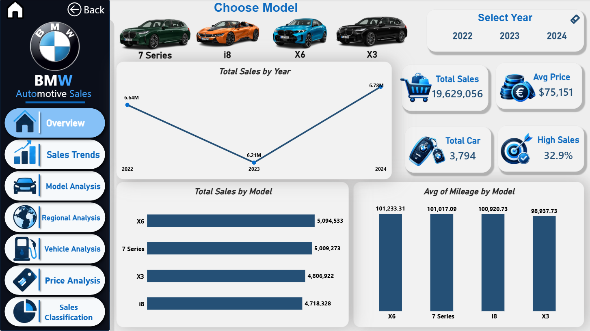

<div align="center">

# 🚘 BMW Sales Dashboard | Power BI

### Turning Automotive Sales Data into Business Insights

An interactive Business Intelligence project exploring BMW sales performance
from 2022 to 2024 through interactive dashboards, model comparisons,
regional analysis, and vehicle pricing insights.

<br>


<br>


</div>

---

## 📌 Project Overview

The **BMW Sales Dashboard** is an interactive Power BI project developed
to explore automotive sales performance across different years, vehicle
models, regions, prices, and vehicle specifications.

The project transforms sales records into meaningful visual insights,
allowing users to investigate performance trends, compare selected BMW
models, and explore differences across market segments.

### Project at a Glance

| Project Detail | Description |
|---|---|
| Project Name | BMW Sales Dashboard |
| Domain | Automotive Sales Analytics |
| Reporting Period | 2022–2024 |
| Selected Models | BMW X6, BMW 7 Series, BMW X3, BMW i8 |
| Filtered Records | 3,794 |
| Main Tool | Microsoft Power BI |
| Data Preparation | Power Query |
| Analytical Calculations | DAX |

> **Important:** Each row represents a sales record, not an individual car.
> Total units sold are calculated by summing `Sales_Volume`.

---

## 📸 Dashboard Preview

### Cover Page


### Overview Dashboard



The Overview page summarizes the main performance indicators and provides
a high-level view of sales performance across the selected models and years.

---

## 📑 Table of Contents

- [Project Overview](#-project-overview)
- [Dashboard Preview](#-dashboard-preview)
- [Business Objectives](#-business-objectives)
- [Dataset](#-dataset)
- [Data Preparation](#-data-preparation)
- [Dashboard Pages](#-dashboard-pages)
- [Key Features](#-key-features)
- [Key Performance Indicators](#-key-performance-indicators)
- [Key Insights](#-key-insights)
- [DAX Measures](#-dax-measures)
- [Tools and Technologies](#-tools--technologies)
- [Repository Structure](#-repository-structure)
- [How to Use](#-how-to-use)
- [Project Demonstration](#-project-demonstration)
- [Limitations](#-limitations--considerations)
- [About the Author](#-about-the-author)

---

## 🎯 Business Objectives

The project explores the following analytical questions:

- How did sales volume change between 2022 and 2024?
- Which selected BMW model generated the highest sales volume?
- Which regions contributed the most to total sales?
- How do fuel types and vehicle specifications vary across sales records?
- How are vehicle prices distributed across categories?
- What proportion of records are classified as High or Low sales?
- Is there an observable relationship between vehicle prices and sales volume?

These questions demonstrate how business intelligence tools can help
organize sales data and support exploratory analysis.

---

## 📂 Dataset

**Dataset:** BMW Car Sales Classification

**Source:** [Open the dataset on Google Drive](https://drive.google.com/file/d/1tNTw4eC6mD0ftpfFu4FjgDnPrabrQWpY/view)

**File:** `BMW_Car_Sales_Classification.csv`

**Format:** CSV

The dataset contains sales records with information about vehicle models,
years, regions, prices, fuel types, and other vehicle characteristics.

### Dataset Columns

| Column | Description |
|---|---|
| `Model` | BMW vehicle model |
| `Year` | Sales year |
| `Region` | Sales region |
| `Color` | Vehicle color |
| `Fuel_Type` | Diesel, Electric, Hybrid, or Petrol |
| `Transmission` | Automatic or Manual |
| `Engine_Size_L` | Engine size in liters |
| `Mileage_KM` | Mileage in kilometers |
| `Price_USD` | Recorded price in USD |
| `Sales_Volume` | Number of units sold in the sales record |
| `Sales_Classification` | High or Low sales classification |

### Analysis Scope

The dashboard focuses on:

- **Years:** 2022, 2023, and 2024
- **Models:** X6, 7 Series, X3, and i8
- **Records after filtering:** 3,794

The selected models were identified as the four highest-selling models
by total sales volume within the selected analysis scope.

---

## 🧹 Data Preparation

Power Query was used to prepare the dataset for analysis.

The workflow included:

1. Importing the CSV dataset.
2. Reviewing the columns and data types.
3. Filtering the reporting period to 2022–2024.
4. Selecting the four target BMW models.
5. Preparing the data for analysis and visualization.
6. Using the filtered dataset in Power BI.

The source CSV is intended to remain unchanged; the reporting filters
are applied in Power Query.

---

## 📊 Dashboard Pages

The report contains **one cover page and seven analytical pages**.

### 1. Cover Page

Introduces the project and provides navigation to the report pages.


### 2. Overview

Presents the main KPIs and a high-level summary of BMW sales performance.


### 3. Sales Trends

Examines annual sales performance and year-over-year changes.


### 4. Model Analysis

Compares the selected BMW models and explores their sales performance
across different categories.


<details>
<summary><b>Explore model-specific analysis</b></summary>

#### BMW i8


#### BMW X6


#### BMW X3


#### BMW 7 Series


</details>

### 5. Regional Analysis

Explores sales distribution across regions and fuel types, including
regional comparisons and geographic visualization.


### 6. Vehicle Analysis

Examines fuel type, transmission, color, engine size, and mileage.


### 7. Price Analysis

Explores average prices, price distributions, and comparisons across
fuel types and regions.


### 8. Sales Classification

Analyzes the distribution of High and Low sales classifications across
regions, fuel types, colors, and years.


---

## ⚡ Key Features

- **Interactive Model Selection:** Image-based car selectors allow users
  to filter the report by the selected model.
- **Cross-Page Filtering:** The selected model remains active while
  navigating between report pages.
- **Year Filtering:** Explore performance across the selected reporting years.
- **Custom Navigation:** Navigate between report pages using a custom menu.
- **Multiple Visual Types:** KPI cards, line charts, matrix heatmaps,
  treemaps, donut charts, funnel charts, gauges, and maps.
- **Model Comparison:** Compare the sales performance of four selected models.
- **Multidimensional Analysis:** Explore sales by region, price, fuel type,
  transmission, color, engine size, and mileage.

---

## 📈 Key Performance Indicators

The report uses KPIs to summarize sales performance.

| KPI | Description |
|---|---|
| Total Sales | Total units sold, calculated using `Sales_Volume` |
| Average Price | Average recorded vehicle price |
| Sales Records | Number of records remaining after filtering |
| High Sales % | Percentage of records classified as High |
| YoY Growth % | Percentage change in sales compared with the previous year |
| Average Sales per Record | Average sales volume per sales record |

> KPI values depend on the selected filters and the DAX measures used
> in the Power BI report.

---

## 💡 Key Insights

The following results were reported for the four selected models during
the 2022–2024 reporting period.

### Overall Performance

**19,629,056 units sold** across **3,794 sales records**.

The reported average price was approximately **$75,151**.

### Leading Model

**BMW X6** recorded the highest total sales volume:

**5,094,533 units**

BMW 7 Series followed with **5,009,273 units**.

### Annual Sales Trend

| Year | Approximate Total Sales |
|---|---:|
| 2022 | 6.64 million |
| 2023 | 6.21 million |
| 2024 | 6.78 million |

Sales declined by approximately **6.46%** in 2023 and increased by
approximately **9.07%** in 2024.

### Regional Performance

- **North America:** 3,483,600 units
- **Africa:** 3,036,333 units

### Fuel Type

- **Hybrid:** 5,099,631 units
- **Diesel:** 4,671,374 units

### Sales Classification

Approximately **33% of records** were classified as High, accounting
for approximately **54% of total sales volume**.

### Price and Sales Volume

The analysis indicated a correlation close to zero between price and
sales volume in the selected data.

> These results are descriptive and should not be interpreted as evidence
> of causal relationships. Verify reported figures against the final
> Power BI report before using them in external presentations.

---

## 🧮 DAX Measures

The following examples illustrate common calculations used in the project.

Replace `BMW_Car_Sales_Classification` with the actual table name in
your Power BI model if necessary.

### 1. Total Sales

```dax
Total Sales =
SUM(
    BMW_Car_Sales_Classification[Sales_Volume]
)
```

### 2. Average Price

```dax
Avg Price =
AVERAGE(
    BMW_Car_Sales_Classification[Price_USD]
)
```

### 3. High Sales Percentage

```dax
High Sales % =
DIVIDE(
    CALCULATE(
        COUNTROWS(BMW_Car_Sales_Classification),
        BMW_Car_Sales_Classification[Sales_Classification] = "High"
    ),
    COUNTROWS(BMW_Car_Sales_Classification)
)
```

### 4. Year-over-Year Growth

```dax
YoY Growth % =
VAR CurrYear =
    MAX(BMW_Car_Sales_Classification[Year])

VAR CurrSales =
    CALCULATE(
        [Total Sales],
        BMW_Car_Sales_Classification[Year] = CurrYear
    )

VAR PrevSales =
    CALCULATE(
        [Total Sales],
        FILTER(
            ALL(BMW_Car_Sales_Classification[Year]),
            BMW_Car_Sales_Classification[Year] = CurrYear - 1
        )
    )

RETURN
    DIVIDE(CurrSales - PrevSales, PrevSales)
```

### 5. Top Region

```dax
Top Region =
VAR RegionSales =
    ADDCOLUMNS(
        ALL(BMW_Car_Sales_Classification[Region]),
        "SalesAmount", [Total Sales]
    )

VAR TopRegion =
    TOPN(
        1,
        RegionSales,
        [SalesAmount], DESC
    )

RETURN
    CONCATENATEX(
        TopRegion,
        BMW_Car_Sales_Classification[Region],
        ", "
    )
```

> These are illustrative DAX examples. The exact measures in the PBIX
> file may differ from the examples documented here.

---

### Refreshing the Data

To refresh the report, configure the data source in Power Query to point
to the `BMW_Car_Sales_Classification.csv` file.

> The PBIX file contains the report and its data model. Data refresh may
> require updating the source file path in Power Query.

---

## 🎬 Project Demonstration

Watch the project demonstration to explore the dashboard design,
interactive features, and analytical pages.

<div align="center">

### ▶️ BMW Sales Dashboard — Live Walkthrough

**Video demonstration:** [Watch the project on LinkedIn](ADD_LINKEDIN_VIDEO_POST_URL_HERE)

</div>


---

## ⚠️ Limitations & Considerations

- The analysis is limited to four selected BMW models: X6, 7 Series, X3,
  and i8.
- The reporting period covers 2022–2024.
- Each row represents a sales record, not an individual vehicle.
- Total units sold are calculated using the sum of `Sales_Volume`.
- Findings describe the selected dataset and do not establish causation.
- Results should not be assumed to represent all official BMW sales worldwide.
- The dataset source and its definitions should be considered when
  interpreting the results.

---

## 👨‍💻 About the Author

<div align="center">

# Ahmed Khaled Soliman

### Aspiring Data Analyst

**Power BI | SQL | Excel | Data Visualization**

Interested in data analytics, business intelligence, and transforming
raw data into meaningful insights that support better decision-making.

<br>

[](https://github.com/a7med-k4aled)

[](https://www.linkedin.com/in/ahmed-khaled-s/)

</div>

---

## ⭐ Feedback

Thank you for checking out the BMW Sales Dashboard!


<div align="center">

### 🚘 Analyze. Discover. Make Data-Driven Decisions.

**BMW Sales Dashboard | Power BI Portfolio Project**

</div>

---

*This is an educational project. BMW names, logos, and vehicle images
belong to their respective owners.*
